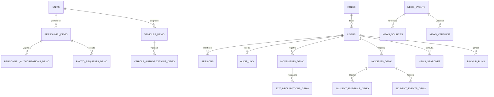

# SISTEMA WEB COEDE
### Comando de Educación y Doctrina del Ejército | Versión Beta 2026

Sistema web integral de inspiración institucional militar, modular, seguro y documentado, desarrollado para la gestión de **Control de Acceso en Puerta Principal**, **Bitácora de Incidencias**, **Síntesis de Información Diaria (SID / Noticias)**, **Padrón de Personal Militar y Civil**, **Padrón Vehicular**, **Reportes Estadísticos** y **Auditoría Forense**.

---

## 1. Arquitectura y Entorno Tecnológico

- **Lenguaje:** PHP 8.3+ (ZTS Visual C++ 2019 x64 compatible).
- **Servidor Web:** Apache 2.4 (XAMPP) con reescritura de URLs mediante `.htaccess` o servidor embebido PHP en `public/`.
- **Base de Datos:** MySQL 8 / MariaDB 10.11+ con transacciones ACID, claves foráneas, índices optimizados y codificación `utf8mb4`.
- **Acceso a Datos:** PDO con consultas preparadas estrictas en todas las operaciones (prevención de inyección SQL).
- **Frontend:** HTML5 semántico, CSS3 institucional militar premium, JavaScript Vanilla asíncrono (Fetch API).
- **Librerías Offline Integradas:**
  - Bootstrap 5.3.3 (CSS y Bundle JS descargados localmente).
  - Bootstrap Icons 1.11.3 (fuentes WOFF/WOFF2 locales).
  - Chart.js 4.4.2 (renderizado de gráficos interactivos locales).
- **Gestión de Dependencias (Composer):**
  - `phpoffice/phpspreadsheet` (lectura, validación y exportación de plantillas Excel).
  - `dompdf/dompdf` (generación de boletines y reportes PDF con portada oficial).
- **Zona Horaria y Reglas Locales:** `America/Lima` configurada a nivel de PHP y sesión MySQL (`SET time_zone = '-05:00'`).

---

## 2. Estructura de Directorios del Proyecto

```
EXAMEN/
├── config/                     # Configuraciones de la aplicación y base de datos
├── database/
│   ├── migrations/             # 7 migraciones SQL estructuradas en orden numérico
│   └── seeds/                  # demo_seed.sql con datos sintéticos no reales
├── public/                     # DocumentRoot público (Único accesible desde Apache)
│   ├── assets/
│   │   ├── css/                # bootstrap.min.css, bootstrap-icons.css, coede-theme.css
│   │   ├── js/                 # bootstrap.bundle.min.js, chart.umd.min.js, coede-core.js, gate-control.js
│   │   └── img/                # coede-shield.svg (Emblema institucional)
│   ├── index.php               # Front Controller único
│   └── .htaccess               # Enrutamiento Apache y cabeceras de seguridad
├── scripts/
│   ├── migrate.php             # Ejecutor CLI de migraciones y configuración de usuario
│   ├── seed.php                # Cargador CLI de datos sintéticos demo
│   ├── backup_cron.php         # Tarea programada diaria para Windows Task Scheduler
│   ├── run_test_suite.php      # Suite de 40 pruebas automatizadas
│   └── generate_sample_assets.php
├── src/
│   ├── Core/                   # Application, Database, Router, Request, Response, Session, Auth, Csrf, View, helpers
│   ├── Middleware/             # AuthMiddleware, RoleMiddleware, CsrfMiddleware
│   ├── Controllers/            # Auth, Home, Personnel, Vehicle, Gate, Incident, Sid, Report, Config, Media, Notification
│   ├── Services/               # GateControlService, IncidentService, SidNewsService, BackupService, ExcelImportService, etc.
│   └── Views/                  # Vistas modulares (.php) con layouts institucionales
├── storage/                    # Directorio PRIVADO fuera de la web
│   ├── backups/                # Contenedores ZIP cifrados/privados (retención 90 días)
│   ├── evidence/               # Archivos de evidencias de incidentes
│   ├── photos/                 # Fotografías privadas de trabajadores
│   ├── templates/              # Plantillas Excel descargables
│   └── logs/
├── .env                        # Variables de entorno activas (ignorado en Git)
├── .env.example                # Plantilla de entorno
├── composer.json               # Configuración de librerías y autoload PSR-4 (App\)
├── iniciar_servidor.bat        # Lanzador para servidor local independiente
├── ejecutar_migraciones.bat    # Lanzador de base de datos
├── ejecutar_pruebas.bat        # Lanzador de suite de pruebas
└── generar_respaldo.bat        # Lanzador de copia de seguridad
```

---

## 3. Guía Paso a Paso de Instalación y Puesta en Marcha

### Requisitos Previos:
1. Windows 10/11 con XAMPP instalado en `C:\xampp` (con módulos Apache y MySQL/MariaDB iniciados).
2. PHP 8.3+ configurado en el PATH del sistema.

### Pasos de Instalación:

1. **Configurar la Base de Datos y las Migraciones:**
   Haga doble clic en el archivo `ejecutar_migraciones.bat` o ejecute desde PowerShell:
   ```powershell
   php scripts/migrate.php
   php scripts/seed.php
   ```
   *El script detectará automáticamente el motor (MariaDB/MySQL), creará la base `coede_db` y el usuario seguro `coede_app` con contraseña `CoedeSegura2026!`, sin utilizar `root` en la aplicación.*

2. **Acceso al Sistema en Localhost:**
   Dispone de dos alternativas operativas:
   - **Opción A (Mediante Apache de XAMPP - Recomendada):**
     Abra su navegador web en la dirección:
     [http://localhost/coede_beta](http://localhost/coede_beta)
   - **Opción B (Servidor Independiente en Puerto 8080):**
     Haga doble clic en `iniciar_servidor.bat` y abra:
     [http://localhost:8080](http://localhost:8080)

3. **Credenciales de Demostración Iniciales:**
   - **Perfil Administrador:**
     - Usuario: `admin`
     - Contraseña: `AdminCoede2026!`
     - Permisos: Acceso total (Personal, Vehículos, Puerta, SID, Incidencias, Reportes, Configuración, Auditoría).
   - **Perfil Servicio (Guardia de Puerta):**
     - Usuario: `servicio`
     - Contraseña: `ServicioCoede2026!`
     - Permisos: Control de Puerta, Registro de Incidencias con Evidencias, Solicitud de Foto y Búsqueda/Exportación SID. *Restricción estricta en servidor: no puede editar ni borrar registros.*

---

## 4. Diagrama Entidad-Relación (Mermaid)



---

## 5. Matriz de Ciberseguridad y Privacidad

| Control | Implementación Técnica en COEDE |
| :--- | :--- |
| **Prevención SQL Injection** | Consultas preparadas PDO estrictas (`PDO::ATTR_EMULATE_PREPARES => false`) en el 100% de consultas. |
| **Prevención XSS** | Escape contextual mediante helper `e()` con `htmlspecialchars(..., ENT_QUOTES, 'UTF-8')`. |
| **Prevención CSRF** | Tokens criptográficos de 64 caracteres validados por `CsrfMiddleware` en toda petición `POST`. |
| **Sesión Única** | Token de sesión verificado en tabla `sessions`. Un nuevo inicio revoca automáticamente sesiones previas. |
| **Cierre por Inactividad** | Timeout a los 15 minutos exactos con aviso modal preventivo a los 14 minutos (60s countdown). |
| **Protección ZIP Traversal** | Comprobación estricta de rutas (`..`), cabecera binaria MIME y límite de 500 archivos contra ZIP bombs. |
| **Privacidad de Fotos** | Fotografías en `storage/photos/` fuera del directorio público; entrega autenticada por `MediaController`. |
| **Inyección de Fórmulas** | Sanitización de celdas en exportación Excel que comiencen con `=`, `+`, `-`, `@`. |
| **Auditoría Forense** | Tabla `audit_log` de solo lectura en la interfaz, sin botón de eliminación ni para el Administrador. |

---

## 6. Ejecución de la Suite de Pruebas

Para validar el 100% de los requisitos funcionales, de arquitectura y de seguridad:
```powershell
php scripts/run_test_suite.php
```
*Supera exitosamente las 40 pruebas unitarias y de integración que abarcan desde el entorno hasta la política de retención de 90 días.*

